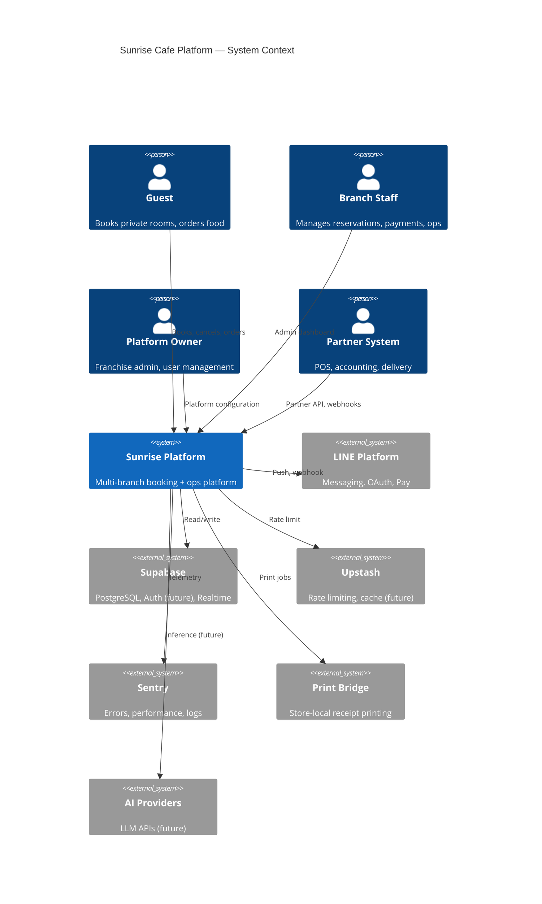
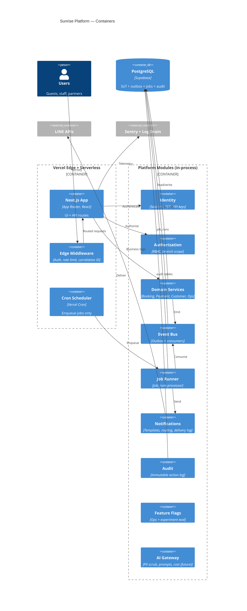
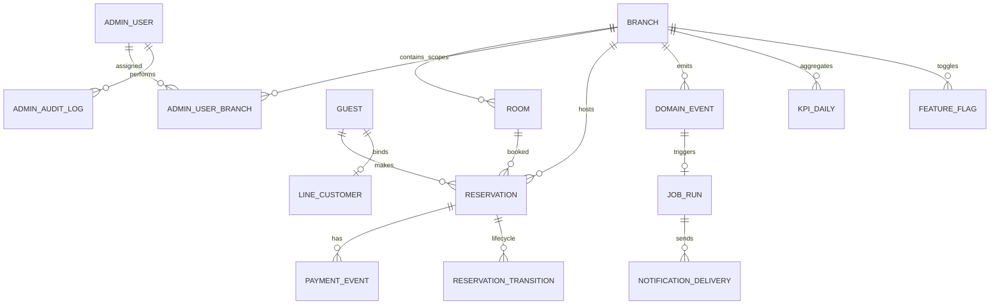
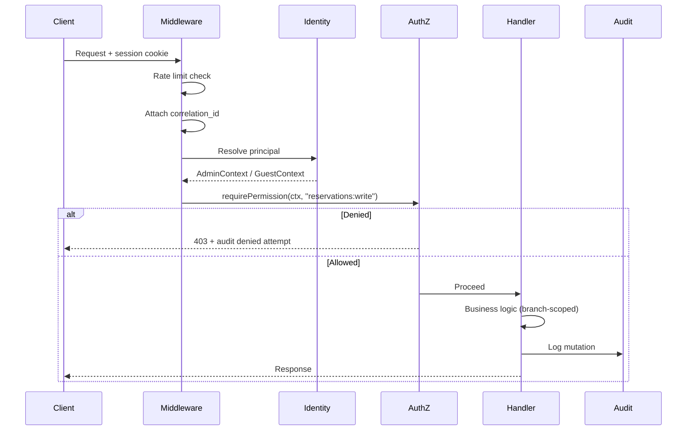
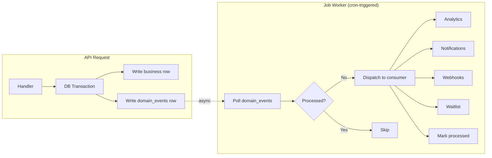
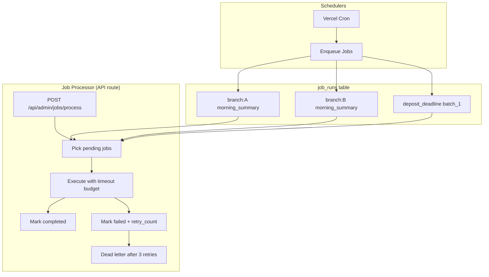
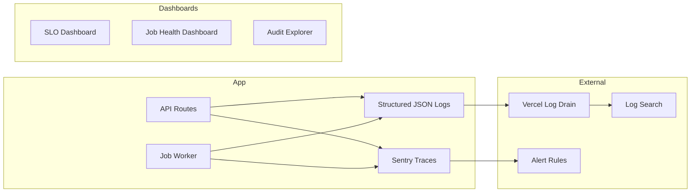
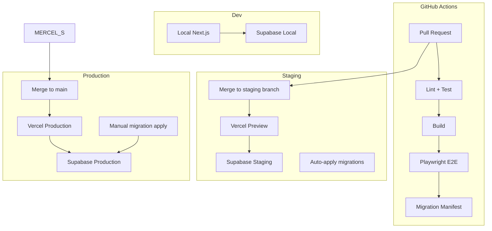
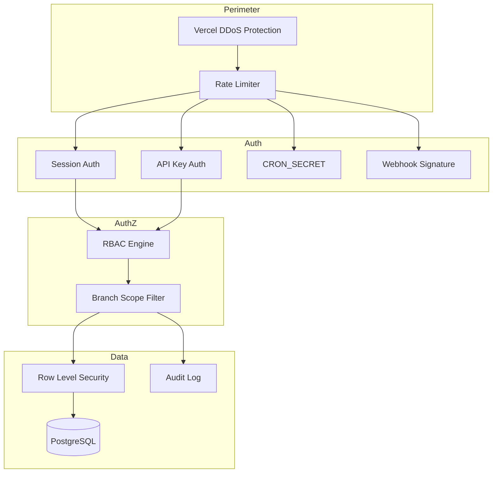

# Enterprise Target Architecture

**Date:** 2026-07-10  
**Status:** Target state (not yet implemented)  
**Horizon:** Platform scale — 100–500 branches, 1,000–10,000 reservations/day  
**Companion docs:** `docs/PHASE8_PLATFORM_REVIEW.md`, `docs/PHASE8_PLATFORM_ROADMAP.md`

---

## 1. Architecture Vision

Sunrise Cafe evolves from a **monolithic Next.js application with PostgreSQL** into a **modular monolith with platform primitives** — without splitting into microservices until organizational or scaling constraints demand it.

### Design principles

1. **Branch is the tenant boundary** — every query, permission, and event carries `branch_id`.
2. **PostgreSQL remains source of truth** — outbox, job queue, and audit live in the same database initially.
3. **Async by default for side effects** — notifications, analytics, integrations consume events, not inline calls.
4. **Secure by default** — deny unless permission explicitly granted; audit every mutation.
5. **Deployable units stay small** — modular monolith, not distributed monolith.
6. **Human-in-the-loop for AI** — no autonomous guest-facing actions in v1.

### Anti-patterns to avoid

- Microservices before team/org scale requires it.
- External message broker before outbox pattern is proven.
- Feature flags for every line of code (use for rollouts and kill switches only).
- AI features before event and audit infrastructure exists.

---

## 2. System Context (Target State)



---

## 3. Container Diagram (Target State)



---

## 4. Layered Architecture

```
┌─────────────────────────────────────────────────────────────────────────┐
│                         Presentation Layer                               │
│  Guest UI (/book)  │  Admin UI (/admin)  │  Partner API (/api/v1)     │
└────────────────────────────────┬────────────────────────────────────────┘
                                 │
┌────────────────────────────────▼────────────────────────────────────────┐
│                         API Gateway Layer                                │
│  Correlation ID │ Rate Limit │ Auth │ RBAC │ Audit │ Feature Flags      │
└────────────────────────────────┬────────────────────────────────────────┘
                                 │
┌────────────────────────────────▼────────────────────────────────────────┐
│                         Domain Layer                                     │
│  ┌──────────┐ ┌──────────┐ ┌──────────┐ ┌──────────┐ ┌──────────┐      │
│  │ Booking  │ │ Payment  │ │ Customer │ │ Analytics│ │ Ops      │      │
│  │ Service  │ │ Service  │ │ Service  │ │ Service  │ │ Service  │      │
│  └────┬─────┘ └────┬─────┘ └────┬─────┘ └────┬─────┘ └────┬─────┘      │
│       └────────────┴────────────┴────────────┴────────────┘             │
│                                 │                                        │
│                    Domain Events (in-process + outbox)                   │
└────────────────────────────────┬────────────────────────────────────────┘
                                 │
┌────────────────────────────────▼────────────────────────────────────────┐
│                         Infrastructure Layer                             │
│  Repositories │ Outbox │ Job Queue │ Notification Adapters │ AI Gateway │
└────────────────────────────────┬────────────────────────────────────────┘
                                 │
┌────────────────────────────────▼────────────────────────────────────────┐
│                         Data Layer                                       │
│  PostgreSQL (Supabase) │ Object Storage (future) │ Cache (Upstash)      │
└─────────────────────────────────────────────────────────────────────────┘
```

---

## 5. Domain Model & Bounded Contexts



### Domain responsibilities

| Domain | Owns | Publishes events | Consumes events |
|--------|------|------------------|-----------------|
| **Booking** | Reservations, availability, waitlist, recurring | `reservation.created`, `.cancelled`, `.status_changed` | `payment.confirmed` |
| **Payment** | Payment events, deposit status, reconciliation | `payment.received`, `.approved`, `.rejected` | `reservation.created` |
| **Customer** | Profiles, retention, LINE binding | `customer.linked`, `.retention_eligible` | `reservation.completed` |
| **Analytics** | Events, KPIs, demand snapshots | — | All domain events |
| **Operations** | Recommendations, business actions, morning summary | `action.created`, `.resolved` | `kpi.daily_computed` |
| **Platform** | Users, RBAC, audit, flags, jobs | `admin.*`, `flag.changed` | — |

---

## 6. Identity & Authorization Architecture



### Principal types

| Principal | Token | Claims |
|-----------|-------|--------|
| `guest` | booking_code + phone hash | `reservation_ids[]` |
| `admin_user` | HMAC session | `sub`, `role`, `branch_ids`, `exp` |
| `service` | CRON_SECRET / API key | `scope`, `branch_ids` |
| `partner` | API key (P2) | `branch_id`, `permissions[]` |

### Authorization rules

1. **Default deny** — no permission string → 403.
2. **Branch scope** — query MUST filter by `branch_ids` unless owner.
3. **Owner bypass** — `branch_ids: null` = all branches.
4. **Legacy session** — `legacy: true` → owner (until deprecated).

---

## 7. Event-Driven Architecture

### Transactional outbox pattern



### Event schema (standard envelope)

```typescript
interface DomainEvent {
  id: string;                    // UUID
  type: string;                  // "reservation.cancelled"
  aggregate_type: string;        // "reservation"
  aggregate_id: string;          // reservation UUID
  branch_id: string;
  payload: Record<string, unknown>;
  metadata: {
    correlation_id: string;
    actor_id: string | null;
    actor_type: "guest" | "admin" | "system";
  };
  created_at: string;            // ISO 8601
  processed_at: string | null;
}
```

### Event catalog (initial)

| Event | Trigger | Consumers |
|-------|---------|-----------|
| `reservation.created` | POST /api/reservations | Analytics, LINE (deposit request), Outbox |
| `reservation.cancelled` | Cancel flow | Waitlist, Analytics, LINE, Audit |
| `reservation.status_changed` | Admin status update | Analytics, Audit |
| `payment.received` | LINE webhook | Payment review, Audit |
| `payment.approved` | Admin approve | Reservation update, LINE, Analytics |
| `deposit.deadline_passed` | Cron | Cancel reservation, LINE, Waitlist |
| `waitlist.slot_available` | Cancel consumer | LINE to waitlist guest |
| `kpi.daily_computed` | KPI cron | Ops recommendations |

---

## 8. Background Job Architecture



### Job types

| Job | Schedule | Fan-out | Timeout budget |
|-----|----------|---------|----------------|
| `morning_summary` | Daily 08:00 Taipei | Per branch | 30s per branch |
| `line_reminder_1d` | Daily 20:00 Taipei | Per branch | 60s per branch |
| `line_reminder_7d` | Daily 20:00 Taipei | Per branch | 60s per branch |
| `deposit_deadline` | Daily 20:00 Taipei | Batched (50/res) | 120s total |
| `no_show_scan` | Daily 22:00 Taipei | Per branch | 30s per branch |
| `demand_collect` | Daily 01:00 Taipei | Per branch | 60s per branch |
| `kpi_materialize` | Daily 02:00 Taipei | Per branch | 60s per branch |
| `analytics_retention` | Monthly | Global | 300s |
| `outbox_consume` | Every 1 min | Batched (100 events) | 60s |

### Retry policy

- Exponential backoff: 1m, 5m, 30m.
- Max 3 retries → dead letter (`status = 'dead'`).
- Alert on dead letter count > 0.

---

## 9. Notification Platform Architecture

```mermaid
flowchart LR
    subgraph Trigger
        EV[Domain Event] --> NS[Notification Service]
    end

    subgraph NS["Notification Service"]
        TPL[Template Engine] --> ROUTE[Channel Router]
        ROUTE --> LINE_C[LINE Customer]
        ROUTE --> LINE_G[LINE Group]
        ROUTE --> SMS[SMS (future)]
        ROUTE --> EMAIL[Email (future)]
    end

    subgraph Tracking
        LINE_C --> DL[notification_deliveries]
        LINE_G --> DL
        SMS --> DL
        EMAIL --> DL
    end
```

### Template resolution

1. Load template by `template_id` + `branch_id` (branch override → global default).
2. Resolve variables from event payload + `branches` table (`display_name`, `payment_info`).
3. Send via channel adapter.
4. Record delivery status (`pending` → `sent` → `delivered` / `failed`).

### Channel priority (future)

| Use case | Primary | Fallback |
|----------|---------|----------|
| Deposit request | LINE customer | SMS |
| Booking reminder | LINE customer | SMS |
| Ops alert | LINE group | Email |
| Waitlist offer | LINE customer | SMS (time-sensitive) |

---

## 10. Data Architecture

### Table tiers

| Tier | Tables | Retention | Access pattern |
|------|--------|-----------|----------------|
| **Transactional** | reservations, rooms, branches, orders | Indefinite | OLTP, indexed |
| **Audit** | admin_audit_logs, payment_events, reservation_transitions | 2 years hot | Append-only, query by resource |
| **Events** | domain_events, analytics_events | 90 days → archive | Append-only, time-series |
| **Jobs** | job_runs, notification_deliveries | 30 days | Status polling |
| **Analytics** | kpi_daily, demand_snapshots | Indefinite | Aggregation, BI |
| **Config** | feature_flags, experiments, branches.operational_config | Indefinite | Low churn |

### Index strategy

```sql
-- Reservation hot paths
CREATE INDEX idx_reservations_branch_date ON reservations (branch_id, start_time);
CREATE INDEX idx_reservations_status_deposit ON reservations (status, is_deposit_paid)
  WHERE status IN ('pending', 'confirmed');

-- Outbox consumer
CREATE INDEX idx_domain_events_unprocessed ON domain_events (created_at)
  WHERE processed_at IS NULL;

-- Job processor
CREATE INDEX idx_job_runs_pending ON job_runs (scheduled_at)
  WHERE status = 'pending';
```

### Read replica routing (P2)

- **Writes:** Primary only.
- **BI queries:** Read replica via Supabase connection pooler.
- **Availability checks:** Primary (consistency required).

---

## 11. API Architecture

### API surfaces

| Surface | Path prefix | Auth | Versioning |
|---------|-------------|------|------------|
| **Public** | `/api/availability`, `/api/reservations` | Guest/rate limit | Unversioned (stable) |
| **Guest** | `/api/my-bookings`, `/api/cancel-booking` | booking_code | Unversioned |
| **Admin** | `/api/admin/*` | Session + RBAC | Unversioned (internal) |
| **Partner** | `/api/v1/*` | API key | URL versioned |
| **System** | `/api/webhooks/*` | Signature | Unversioned |
| **Cron** | `/api/admin/reminders/*`, `/api/admin/jobs/*` | CRON_SECRET | Internal |

### Partner API design (P2)

```
GET  /api/v1/branches/{branch_id}/reservations?date=2026-07-15
GET  /api/v1/branches/{branch_id}/reservations/{id}
GET  /api/v1/branches/{branch_id}/availability?date=2026-07-15
POST /api/v1/webhooks/subscribe   (register outbound webhook)
```

- API keys scoped to `branch_id` + permission set.
- Rate limit: 100 req/min per key.
- Idempotency-Key header on mutations.

---

## 12. AI Platform Architecture (Future)

```mermaid
flowchart TD
    subgraph Input
        REQ[AI Request] --> GW[AI Gateway]
    end

    subgraph GW["AI Gateway"]
        SCRUB[PII Scrubber] --> PROMPT[Prompt Template]
        PROMPT --> BUDGET[Cost / Rate Check]
        BUDGET --> LLM[LLM Provider]
    end

    subgraph Output
        LLM --> REVIEW{Human approval?}
        REVIEW -->|Required| ADMIN[Admin review UI]
        REVIEW -->|Auto (ops only)| ACTION[Execute action]
        ADMIN --> ACTION
        ACTION --> AUDIT[AI audit log]
    end
```

### AI use case maturity path

| Stage | Use case | Autonomy | Data source |
|-------|----------|----------|-------------|
| 1 | Morning summary narrative | None (generate text) | `kpi_daily`, exceptions |
| 2 | Operational recommendations | Suggest only (existing) | Rules + KPIs |
| 3 | Demand anomaly detection | Alert | `demand_snapshots` |
| 4 | Guest FAQ (LINE) | Human-approved responses | Menu, policies KB |
| 5 | Demand forecasting | Auto inform pricing suggestions | Historical demand |

### Guardrails

- PII scrubbing before any LLM call.
- Cost cap per branch per day.
- All AI outputs logged in `ai_audit_logs`.
- Guest-facing responses require human approval in stages 1–4.

---

## 13. Observability Architecture



### Correlation model

Every request and job carries:

```json
{
  "correlation_id": "uuid",
  "branch_id": "branch-uuid or null",
  "actor_id": "admin-user-uuid or null",
  "route": "/api/reservations",
  "duration_ms": 142
}
```

### Alert rules

| Alert | Condition | Severity |
|-------|-----------|----------|
| Cron failure | `job_runs.status = 'dead'` | P1 |
| Outbox backlog | unprocessed events > 1000 | P2 |
| Booking error rate | 5xx > 1% on POST /api/reservations | P1 |
| LINE delivery failure | `notification_deliveries.failed` > 10/hour | P2 |
| SLO burn | Error budget < 25% remaining | P1 |

---

## 14. Deployment Architecture



### Environment parity

| Concern | Dev | Staging | Production |
|---------|-----|---------|------------|
| Database | Supabase local / dev project | Staging project | Production project |
| LINE | Test channel | Test channel | Production channels |
| Rate limit | Disabled | Upstash (low limits) | Upstash (production) |
| Sentry | Disabled | Enabled (low sample) | Enabled |
| Crons | Manual trigger | Scheduled (offset) | Scheduled |

### Migration strategy

1. All migrations are **additive** (new tables, columns, indexes).
2. Destructive changes require two-phase deploy (add → migrate → remove).
3. Manifest verification in CI prevents drift.
4. Target: automated apply to staging; production with approval gate.

---

## 15. Security Architecture



### Security controls by layer

| Layer | Control |
|-------|---------|
| Edge | Rate limiting (mandatory), DDoS protection |
| API | RBAC, input validation, CSRF on admin |
| Data | RLS on sensitive tables, branch_id filtering |
| Secrets | Vercel env vars, no secrets in code |
| Audit | All mutations logged with actor |
| External | LINE webhook HMAC, partner API key rotation |

---

## 16. Scalability Model

### Horizontal scaling (current path)

| Component | Scale mechanism | Limit |
|-----------|----------------|-------|
| API routes | Vercel serverless auto-scale | Cold starts |
| Database | Supabase vertical + read replica | Connection pool |
| Crons | Job fan-out (per-branch) | Vercel cron count |
| LINE | Queue + backoff | LINE rate limits |
| Static assets | Vercel CDN | — |

### Capacity estimates (target architecture)

| Metric | 50 branches | 200 branches | 500 branches |
|--------|-------------|--------------|--------------|
| Reservations/day | 500 | 2,000 | 5,000 |
| Domain events/day | 5,000 | 20,000 | 50,000 |
| Job runs/day | 500 | 2,000 | 5,000 |
| Notification deliveries/day | 2,000 | 8,000 | 20,000 |
| `kpi_daily` rows/day | 50 | 200 | 500 |
| PostgreSQL storage/year | ~5 GB | ~20 GB | ~50 GB |

All within Supabase Pro capacity with read replica and proper indexing.

### When to split services

| Signal | Action |
|--------|--------|
| Cron timeout despite fan-out | External worker (Inngest, Railway) |
| BI queries impact OLTP | Read replica + materialized views |
| Team > 8 engineers on platform | Extract notification service |
| Multi-region latency > 200ms | Edge deployment + regional DB |
| Partner API traffic > 50% | Dedicated API gateway |

---

## 17. Migration Path — Current → Target

```mermaid
flowchart LR
    subgraph Today["Today (Phase 7)"]
        T1[Monolith Next.js]
        T2[supabase-admin.ts hub]
        T3[Inline side effects]
        T4[Vercel cron sequential]
        T5[RBAC partial]
    end

    subgraph P0["P0 (Phase 9a)"]
        P0A[Full RBAC]
        P0B[Job fan-out]
        P0C[Rate limit required]
    end

    subgraph P1["P1 (Phase 9b)"]
        P1A[Domain services]
        P1B[Outbox pattern]
        P1C[Audit middleware]
        P1D[KPI materialized]
    end

    subgraph P2["P2 (Phase 10)"]
        P2A[Lifecycle FSM]
        P2B[Partner API]
        P2C[Multi-channel notify]
    end

    subgraph Future["Future (Phase 11+)"]
        F1[AI Gateway]
        F2[SSO]
        F3[Multi-region]
    end

    Today --> P0 --> P1 --> P2 --> Future
```



### What stays the same

- Next.js monolith on Vercel (through P2).
- Supabase PostgreSQL as source of truth.
- LINE as primary notification channel.
- Guest booking flow (phone + booking_code).
- Manual production migrations (until P1 staging automation).

### What changes

- Side effects move from inline → outbox → consumers.
- Crons move from do-work → enqueue → worker.
- Auth moves from binary admin → full RBAC on every route.
- Data access moves from `supabase-admin.ts` → domain repositories.
- BI moves from raw queries → materialized KPIs.

---

## 18. Architecture Decision Records (Summary)

| ADR | Decision | Rationale |
|-----|----------|-----------|
| ADR-009 | Modular monolith over microservices | Team size, operational simplicity |
| ADR-010 | PostgreSQL outbox over external broker | Same DB, no new infra, proven pattern |
| ADR-011 | `job_runs` fan-out over per-branch crons | Vercel cron count limits |
| ADR-012 | Code-versioned permissions over DB ACL | Avoid ACL explosion, git-reviewed |
| ADR-013 | Branch as tenant boundary | Aligns with hospitality domain |
| ADR-014 | Human-in-the-loop AI v1 | Brand risk, PDPA compliance |
| ADR-015 | Partner API URL versioning (`/api/v1`) | Stripe/Shopify convention |

*Formal ADR documents to be added to `docs/DECISIONS.md` during implementation.*

---

## Related Documents

- `docs/PHASE8_PLATFORM_REVIEW.md` — Current-state capability assessment
- `docs/PHASE8_PLATFORM_ROADMAP.md` — Prioritization and PR backlog
- `docs/ARCHITECTURE.md` — Current architecture overview
- `docs/PLATFORM_GOVERNANCE.md` — Domain boundaries
- `docs/RBAC.md` — Role and permission reference
- `docs/MULTI_BRANCH_SCALE.md` — Scale analysis
- `docs/SLO.md` — Service level objectives
