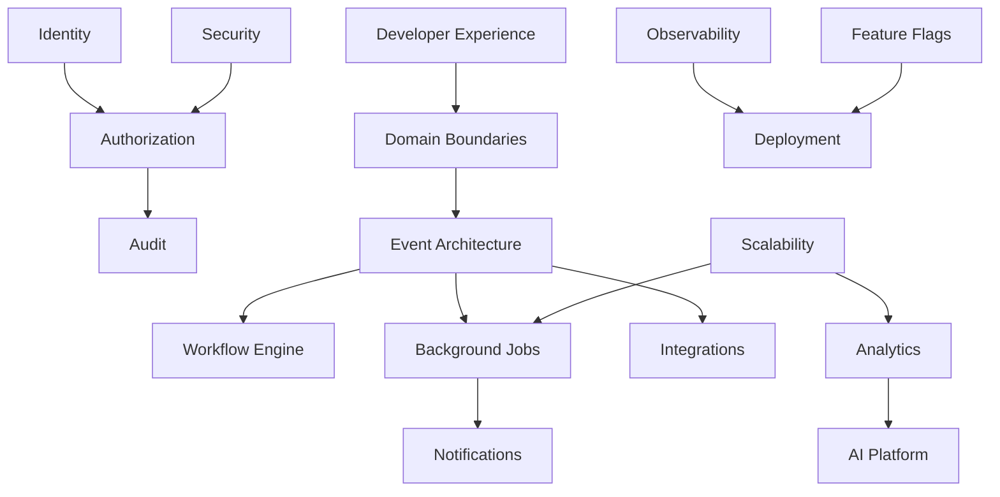

# Phase 8 — Platform Capability Review

**Date:** 2026-07-10  
**Scope:** Architectural assessment across 17 platform capabilities  
**Baseline:** Post Phase 7 (`cursor/phase7-enterprise-platform-3a90`)  
**Goal:** Evaluate readiness to scale from a strong single-company booking app to a **multi-branch hospitality platform** supporting hundreds of branches, thousands of daily reservations, and future AI-driven operations.

**Overall platform maturity:** **B** (solid foundations, uneven enterprise depth)

---

## Executive Summary

Sunrise Cafe has evolved well beyond a prototype: multi-branch data model, LINE dual-channel notifications, payment audit, analytics pipeline, RBAC foundations, and operational automation are in place. The system is **correct and deployable** at current scale (1–10 branches).

The primary gaps for platform-scale are **not** missing features — they are **missing platform primitives**:

| Gap class | Examples |
|-----------|----------|
| **Incomplete enforcement** | RBAC on ~6 of ~40 admin routes; catalog APIs may lack auth |
| **Monolithic coupling** | `supabase-admin.ts` remains the data hub; domain facades are thin re-exports |
| **Synchronous orchestration** | Business flows (cancel → waitlist → LINE) run inline in API handlers |
| **Cron-as-job-system** | 7 Vercel crons with sequential branch loops; no retry/DLQ abstraction |
| **Manual operations** | 36 SQL migrations applied by hand; no staging parity guarantee |

This document assesses each capability independently. Prioritization and PR sequencing live in `docs/PHASE8_PLATFORM_ROADMAP.md`. Target-state design lives in `docs/ENTERPRISE_TARGET_ARCHITECTURE.md`.

---

## Assessment Legend

| Field | Meaning |
|-------|---------|
| **Maturity** | L1 Ad-hoc → L2 Repeatable → L3 Defined → L4 Managed → L5 Optimizing |
| **Migration difficulty** | Low / Medium / High / Very High |
| **Effort** | S (<1 week eng) · M (1–3 weeks) · L (1–2 months) · XL (quarter+) — relative, team-dependent |

---

## 1. Identity Platform

### Current maturity: **L2 — Repeatable**

### Current state

| Actor | Identity mechanism | Storage |
|-------|-------------------|---------|
| **Guest** | `phone` + `booking_code`; optional LINE OAuth binding | `reservations`, `line_customers` |
| **Admin** | HMAC session cookie; Phase 7 adds `admin_users` with scrypt password | Cookie + `admin_users` |
| **System** | `CRON_SECRET`, `ADMIN_PASSWORD` (legacy owner), service role key | Env vars |
| **LINE** | Webhook signature (`LINE_CHANNEL_SECRET`); userId from Messaging API | External |

Legacy path: `{ password }` login → owner-equivalent session (`legacy: true`).

### Strengths

- Guest auth is stateless and privacy-conscious (no account required to book).
- Admin session uses signed cookies with optional `SESSION_SECRET` separation from password.
- Phase 7 `admin_users` table supports email + password per operator.
- LINE OAuth binding path exists for returning guests.

### Weaknesses

- No unified identity graph — guest, admin, and LINE identities are disconnected tables.
- No SSO (Google Workspace, Microsoft Entra) for franchise operators.
- No MFA, device trust, or session revocation UI.
- Password reset / invite flow not implemented.
- Guest identity cannot be promoted to a durable customer profile without LINE binding.

### Technical debt

- Dual login paths (legacy password vs user email) increase test matrix.
- `ADMIN_PASSWORD` remains a break-glass backdoor — necessary today, risky at scale.

### Scaling risks

- Shared admin password at 50+ branches = single point of compromise.
- No per-user session audit → cannot answer "who was logged in when X happened?"

### Recommended architecture

```
┌─────────────────────────────────────────────────────────┐
│                  Identity Provider Layer                 │
│  ┌─────────────┐  ┌──────────────┐  ┌────────────────┐ │
│  │ Guest Token │  │ Admin IdP    │  │ Service Accts  │ │
│  │ (booking)   │  │ (users+SSO)  │  │ (cron, jobs)   │ │
│  └──────┬──────┘  └──────┬───────┘  └───────┬────────┘ │
│         └────────────────┼──────────────────┘          │
│                          ▼                              │
│               Unified Principal Registry                │
│         (guest_id, admin_user_id, line_user_id)         │
└─────────────────────────────────────────────────────────┘
```

- Short term: Bootstrap admin users; deprecate shared password.
- Medium term: Magic-link or SSO for admin; guest ↔ customer profile linking.
- Long term: Optional Supabase Auth or dedicated IdP (Clerk, Auth0) if franchise self-service onboarding is required.

### Migration difficulty: **Medium**

### Effort: **M** (bootstrap + invites) → **L** (SSO)

### Dependencies

- Authorization Platform (RBAC must be enforced before identity expansion matters).
- Audit Platform (login events, session revocation).

---

## 2. Authorization Platform

### Current maturity: **L2 — Repeatable** (L3 design, L2 enforcement)

### Current state

- `src/lib/rbac.ts`: 4 roles, string permissions, branch scope via `admin_user_branches`.
- `requirePermission()` in `admin-api-auth.ts` — adopted on **~6 admin route files**.
- ~25+ admin routes still use `requireAdminApiAuth` only (binary admin).
- BI summary and branch DELETE enforce branch scope; most routes do not.

### Strengths

- Permission model is code-versioned (no ACL explosion in DB).
- Branch scope is a first-class concept (`branch_ids: null` = all branches).
- `admin_permission_audit` records user lifecycle changes.
- Graceful degradation when RBAC tables missing (`migration_required`).

### Weaknesses

- **Enforcement gap** is the #1 security risk — designed RBAC ≠ deployed RBAC.
- No resource-level ACLs (e.g., per-reservation ownership).
- Guest APIs have no branch-scoped rate limit tiers.
- Catalog routes (`/api/rooms`, `/api/branches`) may be writable without admin auth (Phase 6 flagged).

### Technical debt

- Two auth patterns coexist (`requireAdminApiAuth` vs `requirePermission`).
- Permission strings not validated at compile time.

### Scaling risks

- Regional manager with `branch_manager` role can call unprotected endpoints and affect other branches.
- Compliance audits will fail "least privilege" checks.

### Recommended architecture

- **Policy enforcement point:** Single middleware/wrapper on all `/api/admin/*` and sensitive catalog routes.
- **Policy decision point:** `rbac.ts` + optional future OPA/Cedar for complex rules.
- **Default deny:** Unknown route → require explicit permission annotation.

### Migration difficulty: **Low** (rollout is additive)

### Effort: **M** (full route rollout + tests)

### Dependencies

- Identity Platform (meaningful only with per-user accounts).
- Audit Platform (log denied attempts).

---

## 3. Domain Boundaries

### Current maturity: **L2 — Repeatable**

### Current state

```
src/lib/domains/
  booking.ts      → re-exports reservation helpers
  payment.ts      → payment message + events
  customer.ts     → retention, insights
  analytics.ts    → events, KPIs
  operations.ts   → recommendations, business actions
```

`src/lib/supabase-admin.ts` (~477 lines) remains the central data access layer for most operations.

### Strengths

- `docs/PLATFORM_GOVERNANCE.md` documents intended domain map.
- Phase 7 facades establish naming and import boundaries.
- Core booking invariants (overlap check, deposit deadline) are centralized.

### Weaknesses

- Facades are **thin re-exports**, not bounded contexts with owned schemas.
- No domain events — cross-domain calls are direct function imports.
- API routes contain business orchestration (cancel → waitlist → LINE).
- `supabase-admin.ts` creates circular dependency risk as domains grow.

### Technical debt

- Mixed concerns in API handlers: validation, auth, persistence, notification.
- No anti-corruption layer between Supabase row shapes and domain models.

### Scaling risks

- Teams cannot own domains independently — every change touches the monolith hub.
- Refactoring one flow (e.g., payments) risks regressions in booking.

### Recommended architecture

```
┌────────────┐  ┌────────────┐  ┌────────────┐  ┌────────────┐
│  Booking   │  │  Payment   │  │  Customer  │  │  Analytics │
│  Domain    │  │  Domain    │  │  Domain    │  │  Domain    │
│  (service) │  │  (service) │  │  (service) │  │  (service) │
└─────┬──────┘  └─────┬──────┘  └─────┬──────┘  └─────┬──────┘
      │               │               │               │
      └───────────────┴───────────────┴───────────────┘
                          │
                    Event Bus (future)
                          │
                    PostgreSQL (today)
```

- Phase 9 target: Extract `BookingService`, `PaymentService` with owned repositories.
- Keep monolith deploy unit; split **modules** before splitting **services**.

### Migration difficulty: **Medium**

### Effort: **L** (incremental extraction over multiple PRs)

### Dependencies

- Event Architecture (domains communicate via events eventually).
- Developer Experience (module boundaries need lint rules).

---

## 4. Event Architecture

### Current maturity: **L1 — Ad-hoc**

### Current state

- No event bus, outbox, or changelog stream.
- Side effects triggered synchronously in API handlers and crons.
- `analytics_events` is an append-only telemetry table, not a domain event log.
- Supabase Realtime available but not used for domain propagation.

### Strengths

- Simplicity — easy to trace request → outcome in one stack frame.
- `payment_events` provides audit trail for one domain.
- `business_actions` begins operational event tracking.

### Weaknesses

- No idempotent event processing — duplicate webhook deliveries rely on ad-hoc checks.
- No replay capability after bugs or migration.
- Cross-domain workflows (cancel → waitlist → LINE) are fragile under partial failure.

### Technical debt

- LINE push failures after DB commit leave inconsistent external state.

### Scaling risks

- At 1000+ reservations/day, synchronous fan-out in request path increases latency and timeout rates.
- Cannot add new consumers (AI agent, warehouse) without modifying source handlers.

### Recommended architecture

```
API Handler → DB Transaction → Outbox Table → Worker → [LINE, Analytics, Waitlist, AI]
```

- Start with **transactional outbox** in PostgreSQL (no new infra).
- Event schema registry in `docs/DATA_DICTIONARY.md` extension.

### Migration difficulty: **Medium**

### Effort: **L**

### Dependencies

- Background Job System (workers consume outbox).
- Workflow Engine (multi-step sagas).

---

## 5. Workflow Engine

### Current maturity: **L1 — Ad-hoc**

### Current state

| Workflow | Implementation |
|----------|----------------|
| Deposit deadline | `deposit-deadline.ts` cron + inline state transitions |
| Waitlist notify | `waitlist.ts` called from cancel handlers |
| Payment review | Webhook → `payment_events` → admin approve/reject |
| Recurring reservations | API + admin routes |
| Morning summary | Cron aggregation |

All workflows are **imperative code paths**, not declarative state machines.

### Strengths

- Business rules are readable TypeScript with tests.
- Deposit deadline logic is well-documented (ADR-007).

### Weaknesses

- No visible workflow state — operators cannot see "where is this reservation in the lifecycle?"
- No compensation / saga for partial failures.
- Adding a step (e.g., SMS reminder) requires editing multiple call sites.

### Technical debt

- Workflow logic split between crons and API routes.

### Scaling risks

- Complex franchise rules (per-branch deposit policies) will sprawl across conditionals.

### Recommended architecture

- **Phase 1:** Reservation lifecycle state machine (explicit `status` transitions table + audit).
- **Phase 2:** Durable workflow runner for long-running flows (deposit reminders, waitlist expiry).
- **Not recommended now:** Full Temporal/Cadence — overkill until event volume justifies it.

### Migration difficulty: **Medium**

### Effort: **L** (lifecycle FSM) → **XL** (durable workflows)

### Dependencies

- Event Architecture, Background Job System.

---

## 6. Background Job System

### Current maturity: **L2 — Repeatable**

### Current state

- **7 Vercel crons** (`vercel.json`): reminders, deposit deadline, no-show, morning summary, demand collect, analytics retention.
- `CRON_SECRET` protects endpoints.
- Phase 7: `job_runs` table + `cron-batch.ts` for batching; morning-summary writes job runs.
- Sequential branch loops in reminder crons.

### Strengths

- Zero additional infrastructure — crons run on existing Vercel deployment.
- Job run tracking started — foundation for observability.
- `cron-batch.ts` abstracts batch size for scale.

### Weaknesses

- Vercel cron timeout (60s Pro / 300s Enterprise) — risk at 50+ branches.
- No retry with exponential backoff (failed branch blocks or is skipped ad-hoc).
- No dead-letter queue or job dashboard.
- No concurrency control — two cron invocations could overlap.

### Technical debt

- Cron logic duplicated across reminder routes.
- `print-bridge` is external Node.js — not integrated with job system.

### Scaling risks

- **Morning summary at 50 branches:** N+1 room fetches → timeout (documented in `MULTI_BRANCH_SCALE.md`).
- **Deposit deadline:** Must process all unpaid reservations daily — batch size limits needed.

### Recommended architecture

```
┌──────────────┐     ┌─────────────┐     ┌──────────────┐
│ Vercel Cron  │────►│ Job Enqueue │────►│ Worker Pool  │
│ (scheduler)  │     │ (job_runs)  │     │ (branch jobs)│
└──────────────┘     └─────────────┘     └──────────────┘
```

- Short term: Fan-out per-branch jobs in `job_runs`; cron only enqueues.
- Medium term: Supabase Edge Functions or Inngest/Trigger.dev for retries.
- Long term: Dedicated worker service if Vercel limits bind.

### Migration difficulty: **Medium**

### Effort: **M** (job_runs fan-out) → **L** (external queue)

### Dependencies

- Observability (job metrics), Event Architecture (outbox consumer).

---

## 7. Feature Flags

### Current maturity: **L2 — Repeatable** (experiments only)

### Current state

- `experiments` table + `src/lib/experiments.ts` — A/B variants for growth.
- Client loads active experiments via `/api/experiments/active`.
- Analytics events include `experiment` / `variant` properties.
- **No** general-purpose feature flags (kill switches, gradual rollout, per-branch toggles).

### Strengths

- Experiment framework is DB-driven with admin API.
- Privacy-safe — no PII in experiment assignment.

### Weaknesses

- Experiments ≠ feature flags — cannot disable a broken feature in production instantly.
- No per-branch or per-role flag targeting.
- Flag state requires migration + SQL to change (no admin UI for ops flags).

### Technical debt

- Growth experiments conflated with operational feature toggles.

### Scaling risks

- Rolling out multi-branch features without flags forces big-bang deploys.
- Cannot safely test RBAC enforcement per branch.

### Recommended architecture

- Extend `experiments` → `feature_flags` with types: `experiment`, `ops`, `kill_switch`.
- Evaluation SDK: `isEnabled(flag, { branchId, role })` with env override for emergencies.
- Admin UI on `/admin/ops` for ops flags.

### Migration difficulty: **Low**

### Effort: **S**

### Dependencies

- Authorization (who can toggle flags), Audit (flag change log).

---

## 8. Audit Platform

### Current maturity: **L2 — Repeatable**

### Current state

| Audit surface | Table / mechanism |
|---------------|-------------------|
| Payment events | `payment_events` |
| Admin permission changes | `admin_permission_audit` |
| General admin actions | `admin_audit_logs` (Phase 7) |
| Reservation changes | Implicit via `updated_at`; no field-level diff |

### Strengths

- Payment audit is mature (pending_review → approve/reject).
- Permission audit covers user lifecycle.
- `admin_audit_logs` schema exists for general actions.

### Weaknesses

- **Incomplete coverage** — most admin mutations do not write audit logs yet.
- No guest action audit (cancel, reschedule).
- No tamper-evident storage or retention policy.
- No unified audit query API for compliance exports.

### Technical debt

- Audit logging is opt-in per route — easy to forget.

### Scaling risks

- Franchise disputes require "who changed this reservation?" — not answerable today.
- GDPR/CCPA data access requests need structured audit trail.

### Recommended architecture

- Middleware: `auditLog(action, resource, actor, diff)` on all mutating admin routes.
- Standard event schema: `{ actor_id, action, resource_type, resource_id, before, after, ip, ts }`.
- Retention: 2 years hot, archive to cold storage.

### Migration difficulty: **Low**

### Effort: **M**

### Dependencies

- Authorization (actor identity), Identity Platform.

---

## 9. Analytics Platform

### Current maturity: **L3 — Defined**

### Current state

- `analytics_events` append-only table with PII allowlist enforcement.
- `src/lib/analytics.ts` client + server ingest.
- KPI layer: `business-kpis.ts`, BI API, demand snapshots, data quality reports.
- Monthly retention cron (`analytics-retention`).
- Experiments integrate with analytics properties.

### Strengths

- Privacy-by-design (no PII in events).
- Multi-dimensional: `branch_id`, funnel steps, experiment variants.
- Admin dashboards: insights, ops, BI summary.
- Data quality and retention tooling (Phase 5–6).

### Weaknesses

- No real-time streaming — batch/cron oriented.
- BI queries hit raw tables — no materialized aggregates at scale.
- No external warehouse export (BigQuery, Snowflake).
- Product analytics ≠ business analytics — single table serves both.

### Technical debt

- Heavy queries on `reservations` + `analytics_events` for dashboards.

### Scaling risks

- `/admin/insights` at 50 branches with 30-day window → slow without caching.
- `demand_snapshots` growth is linear with branches × rooms × hours — acceptable to ~100 branches.

### Recommended architecture

- Daily KPI materialized view / `kpi_daily` table (cron-populated).
- Separate `product_events` vs `business_metrics` if volumes diverge.
- Optional: Fivetran/Supabase → warehouse for franchise reporting.

### Migration difficulty: **Medium**

### Effort: **M** (materialized KPIs) → **L** (warehouse)

### Dependencies

- Background Job System (KPI cron), Scalability (indexes).

---

## 10. Notification Platform

### Current maturity: **L3 — Defined**

### Current state

- **Dual LINE channels:** Group bot (ops) + Customer bot (guest push).
- `line-notify.ts` (group), `line.ts` (customer), `payment-message.ts` (DB-driven copy).
- Per-branch `line_group_id` with env fallback.
- Notifications: booking confirm, deposit request, reminders (1d, 7d), payment confirm, waitlist, cancel, morning summary.

### Strengths

- Multi-branch LINE routing is production-proven.
- Payment copy is database-driven per branch (no hardcoded accounts).
- Webhook handles payment detection with keyword + screenshot flows.

### Weaknesses

- **Channel lock-in** — LINE only; no SMS, email, or push abstraction.
- No notification preferences per guest.
- No delivery status tracking or retry queue.
- Template management is code + DB strings — no versioned template engine.

### Technical debt

- Two token pairs to rotate; webhook secret tied to group channel.
- Notification sends inline in business logic.

### Scaling risks

- LINE rate limits at high volume (1000+ pushes/hour).
- No fallback channel if LINE is down.

### Recommended architecture

```
┌─────────────────────────────────────┐
│     Notification Service            │
│  templates │ routing │ delivery log │
└───────────┬─────────────────────────┘
            │
    ┌───────┼───────┬─────────┐
    ▼       ▼       ▼         ▼
  LINE    SMS     Email    (future)
```

- Abstract `sendNotification({ channel, template, recipient, context })`.
- `notification_deliveries` table for status + retry.

### Migration difficulty: **Medium**

### Effort: **M** (abstraction + delivery log) → **L** (multi-channel)

### Dependencies

- Event Architecture (async delivery), Background Job System (retries).

---

## 11. AI Platform

### Current maturity: **L1 — Ad-hoc**

### Current state

- `docs/AI_AGENT_GOVERNANCE.md` — policies for AI-assisted development.
- `operational-recommendations.ts` — rule-based suggestions (not ML).
- `business_actions` — human-in-the-loop action tracking.
- No production LLM integration, embeddings, or agent runtime.

### Strengths

- Governance doc anticipates AI features before implementation.
- Recommendation → action loop provides human oversight pattern.
- Data quality tooling produces clean inputs for future models.

### Weaknesses

- No feature store, model registry, or prompt management.
- No guardrails for guest-facing AI (hallucination, PII leakage).
- Analytics data lacks labels for supervised learning.

### Technical debt

- None yet — greenfield within platform.

### Scaling risks

- Ad-hoc LLM calls in API routes will explode cost and latency without gateway.

### Recommended architecture

- **AI Gateway:** Rate limits, PII scrubbing, prompt templates, cost tracking.
- **Use cases (ordered):** Ops summarization → demand forecasting → guest FAQ bot.
- **Human-in-the-loop:** All guest-facing AI actions require approval initially.

### Migration difficulty: **Low** (greenfield)

### Effort: **M** (gateway + ops summary) → **XL** (forecasting, agents)

### Dependencies

- Analytics Platform (features), Event Architecture (triggers), Audit (AI action log).

---

## 12. Integration Platform

### Current maturity: **L2 — Repeatable**

### Current state

| Integration | Pattern |
|-------------|---------|
| LINE Messaging | Webhook + REST push |
| LINE OAuth | Guest binding |
| LINE Pay | URL per branch (manual) |
| Supabase | Direct client + service role |
| Upstash | Optional rate limiting |
| Sentry | Optional error tracking |
| print-bridge | Local HTTP (non-Vercel) |

No generic webhook outbound, API keys for partners, or integration marketplace.

### Strengths

- LINE integration is deep and battle-tested.
- Webhook signature verification implemented.
- `docs/LINE_PAY_INTEGRATION.md` documents payment flow.

### Weaknesses

- No partner API surface (POS, accounting, delivery platforms).
- No OAuth for third-party apps accessing Sunrise data.
- `print-bridge` is per-store manual deployment — not platform-managed.
- Inbound webhooks only (LINE) — no outbound event subscriptions.

### Technical debt

- Integration credentials scattered across env vars and `branches` columns.

### Scaling risks

- Each new integration copies webhook handler patterns.
- Franchise tech stacks (Toast POS, Uber Eats) need standardized connectors.

### Recommended architecture

- **Inbound:** Unified webhook router with signature plugins.
- **Outbound:** Event subscriptions (via Event Architecture) + signed payloads.
- **Partner API:** Versioned REST with API keys scoped to branch.

### Migration difficulty: **Medium**

### Effort: **L**

### Dependencies

- Event Architecture, Authorization (API key scopes), Audit.

---

## 13. Observability

### Current maturity: **L2 — Repeatable**

### Current state

- Sentry (optional): server, edge, client via `instrumentation.ts`.
- `job_runs` for cron tracking.
- `docs/SLO.md` defines targets; no automated SLO dashboard.
- `/api/booking-health`, `/api/admin/diagnose-line` for manual checks.
- Vercel analytics for deployment metrics.

### Strengths

- Sentry integration is properly split by runtime.
- SLO document exists with error budget concept.
- Schema drift API (`/api/admin/schema/status`).

### Weaknesses

- No distributed tracing across API → Supabase → LINE.
- No structured logging standard (JSON logs).
- Cron failures may go unnoticed without proactive alerting.
- No metrics backend (Prometheus/Datadog).

### Technical debt

- `console.log` in crons — not queryable at scale.

### Scaling risks

- Debugging "why didn't branch X get a reminder?" requires manual log archaeology.
- No correlation ID across guest booking → LINE push → webhook.

### Recommended architecture

- Structured logging with `request_id` + `branch_id` on every API call.
- Sentry performance monitoring for critical paths (booking POST, crons).
- Alerting: PagerDuty/Opsgenie on cron failure rate > 5%.

### Migration difficulty: **Low**

### Effort: **M**

### Dependencies

- Background Job System (job metrics), Deployment (log drain config).

---

## 14. Deployment Architecture

### Current maturity: **L3 — Defined**

### Current state

- **Production:** Vercel (Next.js 15), `main` branch auto-deploy.
- **CI:** GitHub Actions — lint, test (158 tests), build, Playwright E2E.
- **Database:** Supabase PostgreSQL; 36 migrations with manifest verification.
- **Crons:** Vercel cron (7 jobs).
- **External:** print-bridge on store LAN.
- **Staging:** Documented (`docs/STAGING.md`) but not enforced in CI.

### Strengths

- CI pipeline is solid with migration manifest check.
- `docs/RELEASE.md` + `CHANGELOG.md` discipline.
- Feature deploys are continuous — no release train required.

### Weaknesses

- **Manual migrations** — highest operational risk; no automated apply.
- No blue-green or canary deploys.
- No preview environment with production-like data (privacy-safe subset).
- print-bridge not in CI/CD.

### Technical debt

- Migration drift between environments until manual apply.

### Scaling risks

- Schema migration at 3am with 50 franchises online — downtime risk.
- No database branching (Supabase branching) in workflow.

### Recommended architecture

- Supabase migration CI apply to staging on merge.
- Preview deploys per PR with seeded test data.
- Consider read replica for BI queries at scale.

### Migration difficulty: **Medium**

### Effort: **M** (staging automation) → **L** (migration CI)

### Dependencies

- Developer Experience, Scalability.

---

## 15. Scalability

### Current maturity: **L2 — Repeatable**

### Current state

| Dimension | Current capacity | Bottleneck |
|-----------|-----------------|------------|
| Branches | ~10 comfortable, ~50 functional | Cron timeouts, admin UX |
| Reservations/day | ~100s | DB indexes adequate |
| Concurrent bookings | App-level overlap check | Row lock contention at extreme |
| Admin users | 1–5 | RBAC not enforced |
| Analytics events | ~10k/day | Table scan for BI |

Phase 7 added `reservations.branch_id` denormalization and composite indexes.

### Strengths

- PostgreSQL overlap exclusion constraint prevents double-booking.
- Branch denormalization started.
- Rate limiting available (Upstash, fail-open).

### Weaknesses

- Single-region Supabase — no geo distribution.
- Vercel serverless cold starts on infrequent admin pages.
- No caching layer (Redis) for hot reads.
- Sequential cron processing.

### Technical debt

- N+1 queries in some cron paths (partially addressed by `fetchRoomsForBranches`).

### Scaling risks

| Scale target | Risk |
|--------------|------|
| 100 branches | Cron timeout without job fan-out |
| 1000 reservations/day | BI query latency |
| 10k guests/day | LINE rate limits, rate limit fail-open |

### Recommended architecture

- Read path: CDN + edge cache for public availability API.
- Write path: Keep PostgreSQL as SoT; optimistic locking on hot rows.
- Cron path: Per-branch job fan-out with `job_runs`.
- BI path: Materialized daily KPIs.

### Migration difficulty: **Medium**

### Effort: **M** → **L** (incremental)

### Dependencies

- Background Job System, Analytics Platform, indexes (Phase 6 migration).

---

## 16. Security

### Current maturity: **L2 — Repeatable**

### Current state

- `docs/SECURITY_MATURITY_PHASE6.md` — route classification.
- HMAC admin sessions, scrypt passwords, LINE webhook signatures.
- RLS on `payment_events` (anon denied).
- Rate limiting (optional Upstash, fail-open).
- PII masking in retention APIs.
- Cron secret protection.

### Strengths

- Security documentation is honest about gaps.
- Payment events RLS prevents anon access.
- Guest auth does not expose full PII in URLs.

### Weaknesses

- RBAC not enforced on all routes (**P0**).
- Rate limit fail-open without Upstash.
- No WAF or bot protection beyond basic rate limits.
- No secrets rotation automation.
- Catalog API auth gaps (Phase 6).

### Technical debt

- `CRON_SECRET` in query string (logged in some proxies).
- Legacy `ADMIN_PASSWORD` break-glass.

### Scaling risks

- Franchise model multiplies attack surface (more admin users, more API keys).
- Compliance (PCI adjacent for payments, Taiwan PDPA) needs audit trail.

### Recommended architecture

- Complete RBAC rollout (P0).
- Mandatory Upstash in production.
- Security headers middleware (CSP, HSTS).
- Annual penetration test at 20+ branches.

### Migration difficulty: **Low–Medium**

### Effort: **M** (RBAC + rate limit) → **L** (compliance program)

### Dependencies

- Identity, Authorization, Audit.

---

## 17. Developer Experience

### Current maturity: **L3 — Defined**

### Current state

- `docs/ONBOARDING.md`, `.env.example`, `scripts/setup-dev.sh`, `scripts/verify-env.sh`.
- 158 unit tests, Playwright E2E, CI on every PR.
- `migrations.manifest.json` + `npm run verify:migrations`.
- `CLAUDE.md` AI operator handbook.
- Domain docs across Phases 4–7.

### Strengths

- Onboarding scripts reduce time-to-first-run.
- Migration manifest prevents drift in CI.
- Comprehensive documentation culture.
- TypeScript + strict patterns in critical paths.

### Weaknesses

- No API schema generation (OpenAPI) — consumers read source.
- Local dev requires real Supabase project (no embedded DB).
- No architecture decision record (ADR) index — scattered in `docs/DECISIONS.md`.
- Module boundary not enforced by lint rules.

### Technical debt

- 36 migrations — long onboarding SQL apply sequence.

### Scaling risks

- New engineers touching `supabase-admin.ts` without domain context.
- No contract tests between domains.

### Recommended architecture

- OpenAPI spec generated from route handlers.
- ESLint `import/no-restricted-paths` for domain boundaries.
- Supabase local dev (`supabase start`) in CI.
- ADR template + index.

### Migration difficulty: **Low**

### Effort: **S** → **M**

### Dependencies

- Domain Boundaries (lint rules matter after extraction).

---

## Cross-Capability Dependency Graph



---

## Maturity Summary Matrix

| # | Capability | Maturity | Effort to L4 | Priority |
|---|------------|----------|--------------|----------|
| 1 | Identity | L2 | M | P1 |
| 2 | Authorization | L2 | M | **P0** |
| 3 | Domain Boundaries | L2 | L | P1 |
| 4 | Event Architecture | L1 | L | P1 |
| 5 | Workflow Engine | L1 | L | P2 |
| 6 | Background Jobs | L2 | M | **P0** |
| 7 | Feature Flags | L2 | S | P1 |
| 8 | Audit | L2 | M | P1 |
| 9 | Analytics | L3 | M | P1 |
| 10 | Notifications | L3 | M | P2 |
| 11 | AI Platform | L1 | M+ | Future |
| 12 | Integrations | L2 | L | P2 |
| 13 | Observability | L2 | M | P1 |
| 14 | Deployment | L3 | M | P1 |
| 15 | Scalability | L2 | M | **P0** |
| 16 | Security | L2 | M | **P0** |
| 17 | Developer Experience | L3 | S | P2 |

---

## Related Documents

- `docs/PHASE8_PLATFORM_ROADMAP.md` — Prioritization, gap analysis, PR strategy
- `docs/ENTERPRISE_TARGET_ARCHITECTURE.md` — Target-state diagrams
- `docs/PHASE7_ARCHITECTURE.md` — Phase 7 baseline
- `docs/PLATFORM_GOVERNANCE.md` — Domain map
- `docs/MULTI_BRANCH_SCALE.md` — 50-branch failure modes
