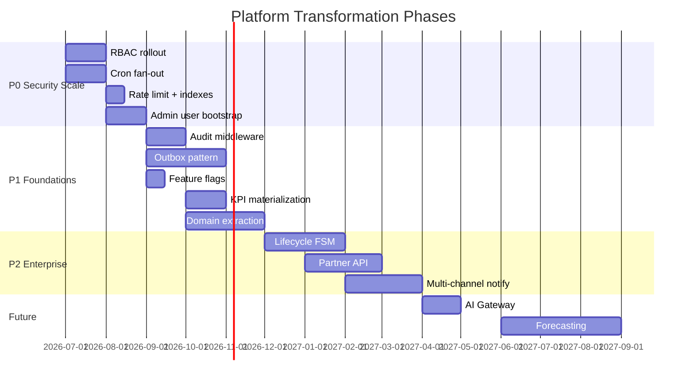

# Phase 8 — Platform Transformation Roadmap

**Date:** 2026-07-10  
**Mission:** Transform Sunrise Cafe from a booking application into a scalable multi-branch platform.  
**This document:** Gap analysis, prioritization, and PR execution strategy.  
**Companion docs:** `docs/PHASE8_PLATFORM_REVIEW.md`, `docs/ENTERPRISE_TARGET_ARCHITECTURE.md`

---

## 1. Strategic Context

### Where we are

Sunrise Cafe is a **well-engineered vertical SaaS** for hospitality booking — not yet a **horizontal platform**. Phases 4–7 added growth analytics, governance, RBAC foundations, and enterprise operations primitives. The codebase is deployable, tested (158 unit tests), and serving production traffic.

### Where we're going

A platform that supports:

| Dimension | Today | Target |
|-----------|-------|--------|
| Branches | 1–10 | 100–500 |
| Reservations/day | ~100 | 1,000–10,000 |
| Admin users | 1–5 (shared password) | 50–500 (scoped roles) |
| Integrations | LINE only | LINE + POS + partner APIs |
| Operations | Manual migrations, reactive | Automated, observable, auditable |
| Intelligence | Rule-based recommendations | AI-assisted ops (human-in-the-loop) |

### What we are NOT doing in Phase 8

- No production code changes.
- No big-bang rewrite.
- No microservices split.

Phase 8 produces the **map**. Phases 9+ execute it in small PRs.

---

## 2. Gap Analysis — Modern SaaS Architectural Principles

We compare against **architectural principles**, not feature parity. Sunrise Cafe will never need Shopify's theme marketplace or GitHub's git protocol — but we should adopt their **platform patterns**.

### Comparison Matrix

| Principle | Shopify | Stripe | Toast POS | Linear | Notion | GitHub | Sunrise (today) | Gap |
|-----------|---------|--------|-----------|--------|--------|--------|-----------------|-----|
| **Multi-tenant isolation** | Shop ID on every row | Account + Connect | Location-scoped | Workspace | Workspace | Org/Repo | `branch_id` (partial) | Medium |
| **Identity & SSO** | Staff + customer accounts | API keys + OAuth | Employee roles | Google SSO | SSO | SSO + PATs | Password + RBAC (partial) | High |
| **Authorization depth** | Staff permissions | Scoped API keys | Role matrix | Team roles | Page permissions | Fine-grained | 4 roles, ~15% routes | **High** |
| **Event-driven core** | Webhooks + Flow | Event destinations | Real-time sync | Issue events | Block updates | Webhooks | Synchronous inline | **High** |
| **Idempotent APIs** | Request IDs | Idempotency keys | Order dedup | — | — | — | Partial (booking code) | Medium |
| **Audit everything** | Admin activity log | Event log | Shift audit | Activity | Version history | Audit log | Payment + partial admin | Medium |
| **Feature flags** | LaunchDarkly-style | Gradual rollouts | Per-location toggles | Feature flags | — | Feature flags | Experiments only | Medium |
| **Observability** | Full APM | Dashboards + alerts | Ops dashboards | Status page | — | Actions logs | Sentry optional | Medium |
| **API versioning** | Stable Admin API | Date-versioned | Partner API v2 | GraphQL | — | REST v3 | Unversioned | Medium |
| **Background jobs** | Shopify Flow + queues | Webhook retries | Kitchen sync | — | — | Actions runners | Vercel crons | Medium |
| **Deployment safety** | Staged rollouts | Canary by % | OTA updates | Gradual | — | — | Direct to prod | Medium |
| **Developer platform** | App Store + APIs | Extensive docs | Partner portal | API | API | API + Apps | Internal only | High |
| **AI integration** | Sidekick | Radar/fraud ML | Menu insights | — | AI blocks | Copilot | Governance doc only | High (future) |

### Principle-by-Principle Lessons

#### From Shopify: Tenant isolation is non-negotiable

Every query must be branch-scoped by default. Shopify's `shop_id` filter is not optional — neither should `branch_id` be. Sunrise has the column (Phase 7) but not universal enforcement.

**Adopt:** Default-deny branch scope in all admin queries; branch context middleware.

#### From Stripe: Idempotency and event reliability

Stripe's API is designed for retries — idempotency keys, event destinations with signing, replay. Sunrise's LINE webhook and cancel→waitlist flow can double-fire or fail silently.

**Adopt:** Transactional outbox; idempotency keys on reservation POST; webhook event log.

#### From Toast POS: Location-centric operations

Toast orients everything around **location** (branch): menus, staff, reporting, hardware. Sunrise's per-branch LINE and payment copy follow this — but admin UX still feels global-first.

**Adopt:** Branch context selector persists across admin; per-branch morning summary default.

#### From Linear: Speed through constraints

Linear's architecture optimizes for a narrow domain with exceptional UX. Sunrise should resist feature sprawl — deepen booking/ops before adding unrelated modules.

**Adopt:** Domain boundary lint rules; "one problem per PR" discipline (already in governance).

#### From Notion: Flexible config without code deploys

Notion lets operators change workspace structure without engineering. Sunrise's `branches.payment_info` and experiments table move this direction — extend to operational config and feature flags.

**Adopt:** DB-driven feature flags; branch `operational_config` expansion.

#### From GitHub: Auditability and permissions as product

GitHub's audit log and fine-grained permissions are first-class product features, not afterthoughts. Sunrise's `admin_audit_logs` exists but is underutilized.

**Adopt:** Audit middleware on all mutations; permission denied logging.

---

## 3. Prioritization Framework

### P0 — Must fix before 20+ branches or franchise onboarding

These are **security, reliability, and scale blockers**. Without them, adding branches increases risk superlinearly.

| ID | Initiative | Why P0 | Effort | Dependencies |
|----|-----------|--------|--------|--------------|
| P0-1 | **RBAC enforcement on all admin routes** | Designed security ≠ deployed security; franchise liability | M | Phase 7 RBAC tables |
| P0-2 | **Catalog API auth hardening** | `/api/rooms`, `/api/branches` writable without admin (Phase 6) | S | P0-1 |
| P0-3 | **Cron job fan-out via `job_runs`** | Sequential loops timeout at 50 branches | M | Phase 7 `job_runs` |
| P0-4 | **Mandatory rate limiting in production** | Fail-open without Upstash = DDoS vulnerable | S | Upstash credentials |
| P0-5 | **Bootstrap admin users + deprecate shared password** | Single password does not scale; audit requires identities | M | P0-1 |
| P0-6 | **Composite indexes + `branch_id` backfill verification** | Query performance at scale | S | Phase 6–7 migrations applied |

**P0 rationale:** A franchise operator onboarding branch #15 should not discover that (a) any staff member can edit any branch, (b) morning summary cron silently times out, or (c) the shared password was leaked. These are existential platform risks, not nice-to-haves.

### P1 — Platform foundations for 50–100 branches

| ID | Initiative | Why P1 | Effort | Dependencies |
|----|-----------|--------|--------|--------------|
| P1-1 | **Audit middleware on admin mutations** | Compliance, dispute resolution | M | P0-1, P0-5 |
| P1-2 | **Transactional outbox (PostgreSQL)** | Reliable side effects; unlocks integrations | L | P0-3 |
| P1-3 | **Notification service abstraction** | Delivery log, retry, template versioning | M | P1-2 |
| P1-4 | **Feature flags (ops + kill switches)** | Safe rollouts per branch | S | — |
| P1-5 | **Daily KPI materialization** | BI dashboard performance | M | P0-6 |
| P1-6 | **Structured logging + correlation IDs** | Debug at scale | M | — |
| P1-7 | **Domain service extraction (booking, payment)** | Reduce `supabase-admin.ts` coupling | L | — |
| P1-8 | **Staging migration automation** | Eliminate prod-only schema surprises | M | CI |
| P1-9 | **Admin invite + password reset flow** | Operator self-service | M | P0-5 |
| P1-10 | **Branch-persistent admin UX context** | Ops efficiency at 50 branches | S | P0-1 |

**P1 rationale:** These build the **platform primitives** that every subsequent feature depends on. Event outbox + job fan-out are prerequisites for reliable notifications, integrations, and AI — not optional polish.

### P2 — Enterprise maturity for 100–500 branches

| ID | Initiative | Why P2 | Effort | Dependencies |
|----|-----------|--------|--------|--------------|
| P2-1 | **Reservation lifecycle state machine** | Visible workflow; reduces spaghetti | L | P1-2 |
| P2-2 | **Partner API (read-only, API keys)** | POS/accounting integrations | L | P0-1, P1-2 |
| P2-3 | **Outbound webhooks (event subscriptions)** | Franchise tech stack connectivity | M | P1-2 |
| P2-4 | **Multi-channel notifications (SMS/email)** | LINE-only risk mitigation | L | P1-3 |
| P2-5 | **OpenAPI spec + contract tests** | DX for partners and internal teams | M | P1-7 |
| P2-6 | **Read replica routing for BI** | Query isolation | M | Supabase plan |
| P2-7 | **Supabase branching in CI** | Safe migration testing | M | P1-8 |
| P2-8 | **Per-branch cron scheduling (timezone-aware)** | Multi-region franchises | M | P0-3 |
| P2-9 | **Guest customer profile (unified)** | Retention, marketing | M | Identity |
| P2-10 | **ESLint domain boundary rules** | Prevent re-coupling | S | P1-7 |

**P2 rationale:** Valuable for enterprise sales and operational excellence, but the system functions correctly without them if P0/P1 are complete.

### Future — AI, marketplace, and geographic scale

| ID | Initiative | Why Future | Effort | Dependencies |
|----|-----------|------------|--------|--------------|
| F-1 | **AI Gateway (PII scrub, cost, prompts)** | No production AI yet; governance exists | M | P1-5, P1-1 |
| F-2 | **Ops AI summarization (human-approved)** | High value, needs clean data | M | F-1 |
| F-3 | **Demand forecasting model** | Needs 6+ months `demand_snapshots` | L | P1-5 |
| F-4 | **Guest FAQ bot (LINE)** | Brand risk without guardrails | L | F-1, P1-3 |
| F-5 | **Integration marketplace / app store** | Requires partner API maturity | XL | P2-2 |
| F-6 | **Multi-region deployment** | Not needed until geographic expansion | XL | P2-6 |
| F-7 | **Durable workflow engine (Temporal)** | Only if saga complexity exceeds outbox | XL | P2-1 |
| F-8 | **print-bridge platform service** | 50 stores = 50 bridges today | L | P2-2 |
| F-9 | **SSO (Google Workspace)** | Franchise IT requirement at scale | M | P0-5 |
| F-10 | **Franchise self-service onboarding** | Business model decision | XL | All P1 |

**Future rationale:** AI and marketplace features are strategic differentiators but depend on reliable platform primitives. Building AI on top of synchronous spaghetti workflows compounds failure modes.

---

## 4. Phased Execution Timeline



*Timeline is indicative sequencing, not calendar commitment. Each bar is a workstream that may contain 5–15 PRs.*

---

## 5. PR Strategy — Small, Independently Mergeable Units

Every future implementation PR must:

1. **Solve one problem** — no drive-by refactors.
2. **Remain deployable** — feature flags or additive schema where needed.
3. **Include tests** — unit tests for logic; integration tests for API contracts.
4. **Include rollback strategy** — documented in PR description.
5. **Avoid unrelated refactoring** — extract helpers only if required by the change.

### PR sizing guide

| Size | Lines changed | Scope | Example |
|------|--------------|-------|---------|
| **XS** | < 100 | Config, docs, single-route fix | Add rate limit env check |
| **S** | 100–300 | Single module, one API route | `requirePermission` on one route |
| **M** | 300–800 | Feature slice, migration + code | Outbox table + one consumer |
| **L** | 800–1500 | Multi-file feature | Domain service extraction |
| **XL** | > 1500 | Split into multiple PRs | — |

**Rule:** PRs larger than **L** must be split unless explicitly approved.

---

## 6. PR Backlog by Priority

### P0 PRs (Phase 9a — Security & Scale)

| PR # | Title | Scope | Tests | Rollback |
|------|-------|-------|-------|----------|
| 9a-01 | `requirePermission` on reservation admin routes | `reservations/route.ts`, `[id]/route.ts`, recurring | Extend `admin-api-auth.test.ts` | Revert to `requireAdminApiAuth` |
| 9a-02 | `requirePermission` on payment routes | `admin/payments/*` | Permission matrix tests | Revert auth wrapper |
| 9a-03 | `requirePermission` on catalog routes | `rooms/*`, `branches/*`, `menu/*` | 403 tests for staff role | Revert auth wrapper |
| 9a-04 | `requirePermission` on ops/cron admin routes | `admin/ops/*`, `admin/reminders/*` (non-cron) | Role tests | Revert |
| 9a-05 | `requirePermission` on remaining admin routes | orders, tables, reports, settings | Bulk permission test | Revert |
| 9a-06 | Auth hardening on public catalog writes | Block unauthenticated POST/PATCH/DELETE on catalog | 401 tests | Revert middleware |
| 9a-07 | Cron fan-out: enqueue per-branch morning summary jobs | `job_runs` insert, cron becomes enqueue-only | Job run tests | Cron runs inline again |
| 9a-08 | Cron fan-out: deposit deadline batch processor | `cron-batch.ts` extension | Batch boundary tests | Sequential fallback |
| 9a-09 | Cron fan-out: LINE reminder jobs | Per-branch reminder enqueue | Mock LINE, job tests | Inline send |
| 9a-10 | Rate limit: fail-closed when Upstash configured | `rate-limit.ts` | Env var tests | fail-open default |
| 9a-11 | Admin user bootstrap CLI/script | `scripts/bootstrap-admin.ts` | Script dry-run test | Manual SQL |
| 9a-12 | Login: warn when legacy password used | Audit log entry | Login test | Remove warn |
| 9a-13 | Verify `reservations.branch_id` backfill | Data quality check in cron | Migration test | N/A (read-only) |
| 9a-14 | RBAC docs update + permission matrix | `docs/RBAC.md` | — | — |

### P1 PRs (Phase 9b — Platform Foundations)

| PR # | Title | Scope | Tests | Rollback |
|------|-------|-------|-------|----------|
| 9b-01 | `admin_audit_logs` write helper | `src/lib/audit.ts` | Unit tests | Stop calling helper |
| 9b-02 | Audit: reservation mutations | cancel, status change, create | Audit row assertions | Remove calls |
| 9b-03 | Audit: payment approve/reject | payment routes | Audit tests | Remove calls |
| 9b-04 | Audit: branch/settings changes | branches, settings routes | Audit tests | Remove calls |
| 9b-05 | Outbox table migration | `domain_events` table | Migration manifest | Drop table |
| 9b-06 | Outbox: emit on reservation create | Booking handler | Event row test | Stop emit |
| 9b-07 | Outbox: emit on cancel | Cancel handler | Event row test | Stop emit |
| 9b-08 | Outbox consumer: analytics | Worker reads outbox → analytics | Consumer test | Disable consumer |
| 9b-09 | Outbox consumer: waitlist notify | Decouple from cancel handler | Integration test | Inline fallback |
| 9b-10 | Feature flags table + eval SDK | `feature_flags`, `isEnabled()` | Eval tests | Drop table |
| 9b-11 | Feature flags admin UI | `/admin/ops` section | E2E optional | Hide UI |
| 9b-12 | `kpi_daily` materialized table | Migration + cron | KPI accuracy tests | Drop table |
| 9b-13 | BI API reads from `kpi_daily` | `bi/summary` route | Compare raw vs materialized | Feature flag |
| 9b-14 | Structured logging middleware | `request_id`, JSON logs | Log format test | Remove middleware |
| 9b-15 | `BookingService` extract (read paths) | `domains/booking.ts` | Existing booking tests | Revert imports |
| 9b-16 | `BookingService` extract (write paths) | Create, cancel | Integration tests | Revert imports |
| 9b-17 | `PaymentService` extract | Payment approve, message | Payment tests | Revert imports |
| 9b-18 | Notification abstraction | `sendNotification()` wrapper | Mock delivery tests | Direct LINE calls |
| 9b-19 | `notification_deliveries` table | Migration + write on send | Delivery log tests | Drop table |
| 9b-20 | Admin invite flow | Email invite token | Invite tests | Disable route |
| 9b-21 | Staging migration CI step | GitHub Actions + Supabase staging | CI green | Remove step |
| 9b-22 | Branch context cookie in admin layout | UI persists branch selection | UI test | Remove cookie |

### P2 PRs (Phase 10 — Enterprise)

| PR # | Title | Scope | Tests | Rollback |
|------|-------|-------|-------|----------|
| 10-01 | Reservation transition table | `reservation_transitions` | FSM tests | Drop table |
| 10-02 | Lifecycle FSM enforce valid transitions | Status update routes | Invalid transition 400 | Loosen validation |
| 10-03 | Partner API keys table | `api_keys` scoped to branch | Key auth tests | Drop table |
| 10-04 | Partner API: read reservations | Versioned `/api/v1/reservations` | Contract tests | Remove route |
| 10-05 | Outbound webhook subscriptions | `webhook_subscriptions` | Signature tests | Drop table |
| 10-06 | OpenAPI spec generation | `docs/openapi.yaml` | Schema validation | Remove spec |
| 10-07 | SMS provider abstraction | Twilio adapter behind notification service | Mock SMS tests | LINE only |
| 10-08 | Domain boundary ESLint rule | `import/no-restricted-paths` | Lint CI | Remove rule |
| 10-09 | Guest customer profile table | `customers` linked to phone/LINE | Profile tests | Drop table |
| 10-10 | BI read replica routing | Supabase read replica config | Query routing test | Primary only |

### Future PRs (Phase 11+)

| PR # | Title | Notes |
|------|-------|-------|
| 11-01 | AI Gateway module | PII scrub, rate limit, cost tracking |
| 11-02 | Ops summary LLM (admin-only) | Human approval required |
| 11-03 | Demand forecast cron | Batch inference job |
| 11-04 | SSO via Supabase Auth or Clerk | Franchise IT requirement |
| 11-05 | Franchise onboarding wizard | Business decision gated |

---

## 7. Rollback Strategy Templates

### Schema migrations

```markdown
## Rollback
- Migration is additive (new table/column) — rollback = stop writing, ignore reads
- OR: Include DOWN migration in PR description (not automated)
- Feature flag gates code path that uses new column
```

### Auth changes

```markdown
## Rollback
- Revert route to `requireAdminApiAuth` (binary admin)
- Legacy password login unaffected
- No session invalidation required
```

### Cron / job changes

```markdown
## Rollback
- Set env `CRON_INLINE_MODE=true` to bypass job_runs fan-out
- Cron handler checks flag and runs legacy sequential path
```

### Feature flags

```markdown
## Rollback
- Disable flag in DB or set env override `FLAG_<NAME>=false`
- No deploy required
```

---

## 8. Success Metrics

| Milestone | Metric | Target |
|-----------|--------|--------|
| P0 complete | Admin routes with `requirePermission` | 100% |
| P0 complete | Cron jobs completing within timeout at 50 branches | 100% |
| P0 complete | Production rate limiting active | Required |
| P1 complete | Admin mutations with audit log | > 95% |
| P1 complete | Side effects via outbox | > 80% of async flows |
| P1 complete | BI dashboard p95 latency (30-day, 50 branches) | < 3s |
| P2 complete | Partner API uptime | 99.5% |
| Future | AI ops summary adoption | > 50% of managers |

---

## 9. Risk Register

| Risk | Likelihood | Impact | Mitigation |
|------|------------|--------|------------|
| RBAC rollout breaks existing admin workflows | Medium | High | Legacy password = owner; feature flag per route |
| Outbox consumer lag | Medium | Medium | Monitoring on outbox depth; alert > 1000 pending |
| Migration applied out of order in prod | Medium | High | Manifest + staging CI (P1-8) |
| LINE rate limit at scale | Low | High | Notification queue + backoff (P1-3) |
| Team velocity drops due to PR granularity | Medium | Low | Batch P0 routes 3–5 per PR if same pattern |
| Over-engineering before product-market fit | Medium | Medium | P2/Future gated on branch count milestones |

---

## 10. Decision Gates

Proceed to next priority tier only when:

| Gate | Condition |
|------|-----------|
| **P0 → P1** | 100% admin routes RBAC-enforced; cron fan-out live; admin users bootstrapped |
| **P1 → P2** | Outbox handling > 80% async side effects; audit on > 95% mutations; KPI materialization live |
| **P2 → Future** | 20+ branches in production OR partner API consumer exists |
| **AI production** | AI Gateway live; audit on AI actions; human approval flow tested |

---

## Related Documents

- `docs/PHASE8_PLATFORM_REVIEW.md` — Per-capability assessment
- `docs/ENTERPRISE_TARGET_ARCHITECTURE.md` — Target-state architecture
- `docs/PHASE7_ARCHITECTURE.md` — Current enterprise baseline
- `docs/PLATFORM_GOVERNANCE.md` — Domain boundaries
- `docs/MULTI_BRANCH_SCALE.md` — Scale failure modes
